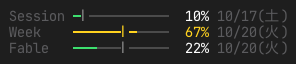

# plan-usage

[English](README.md)



Claude のプランの使用率を、プロンプト下の右端に 3 行で表示します。`/usage` や claude.ai の使用量画面と同じ数値です。

- 現在のセッション (5 時間枠)
- 今週 (全モデル)
- 今週 (モデル別。プランにある場合)

各行にバー・使用率・リセット時刻が並びます。バー上の目印は枠の時間がどれだけ過ぎたかを示し、そのペースより先行していると黄、上限に近づくと赤になります。

## 前提

- function hooks を使う mod です。環境変数 `CLAUDE_CODE_ENABLE_FUNCTION_HOOKS=1` で有効にしてください (`settings.json` の `env` 等)。
- Claude のサブスクリプション (OAuth) でログインしている必要があります。API キーや Bedrock 等のクラウドプロバイダではプランの上限が無いので、何も表示しません。

## インストール

```sh
claude plugin marketplace add crgstar/claude-plugins
claude plugin install plan-usage@crgstar
```

## 注意

- 使用率は `/usage` と同じエンドポイント (`https://api.anthropic.com/api/oauth/usage`) から取得します。公開 API ではないため、予告なく変わったり使えなくなったりすることがあります。
- 取得は最短 5 分おきで、並行するセッション間で結果を共有します。HTTP 429 が返ったときは最長 1 時間まで間隔を空けます。
- 表示は日本語か英語です。Claude Code の `language` 設定があればそれで決め (日本語なら日本語、それ以外は英語)、無ければ OS のロケール (`LC_ALL` / `LC_MESSAGES` / `LANG`) で決めます。
