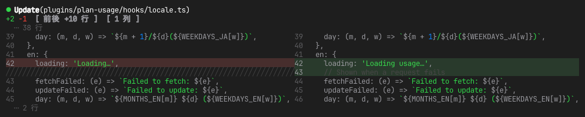
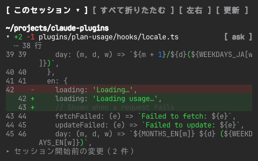

# session-delta

[English](README.md)

セッションで Claude が変えた内容を、2 か所に表示します。

**会話の中**では、Edit と Write の結果を左右に並べて描きます。左が変更前の行、右が変更後の行で、片側に行が無いところは薄い斜線で埋めます。各差分の上の行にボタンが 2 つあります。

- 前後の行を広げる: 変更箇所のみ → 前後 +10 行 → ファイル全体
- 会話の中のすべての差分を、左右表示と 1 列表示 (変更前と変更後の行を別の行に並べる) で切り替える



**チャットの横のペイン**では、プロンプト上の `diff` ボタン (または `/session-delta`) で、変わったファイルをフォルダごとに一覧します。ファイルをクリックすると差分を展開します。上のメニューで比べる範囲を選べます。

- **このセッション**: git リポジトリの未コミットの変更と、リポジトリの外で Claude が編集したファイル。後者は Claude が最初に編集する直前の中身と比べます。最終更新がセッション開始より前のファイルは、別の行にまとめて畳みます。
- **ブランチ全体**: 既定のブランチから分かれてからの変更。
- **ターン**: あなたのメッセージ 1 つに対して Edit と Write で行った変更。新しい順に 63 ターンまで選べます。

ファイルの **ask** を押すと、その差分を次のプロンプトに添えて送ります。テストと生成物のファイルには、組み込みの `/diff` と同じ規則で印が付きます。



## 前提

- function hooks を使う mod です。環境変数 `CLAUDE_CODE_ENABLE_FUNCTION_HOOKS=1` で有効にしてください (`settings.json` の `env` 等)。
- リポジトリの中の変更には `git`、外のファイルには `diff` を使います。

## インストール

```sh
claude plugin marketplace add crgstar/claude-plugins
claude plugin install session-delta@crgstar
```

## コマンド

| コマンド | 動作 |
|---|---|
| `/session-delta` | 変更一覧を開く |
| `/session-delta off` | 会話の中の差分を標準の表示に任せる |
| `/session-delta on` | 会話の中の差分を再び左右に並べる |
| `/session-delta colors` | 差分の色の案を開く |

## 注意

- git の外のファイルを比べるため、セッションで Claude が各ファイルを最初に編集する直前に、その写しをプラグインのデータフォルダ (`~/.claude/plugins/data/session-delta-crgstar/first-touches/`) に保存します。1 MB を超えるファイルは写しません。最後の更新から 30 日を過ぎたセッションの写しは、その後にセッションが始まったときに消します。
- git の外で、Edit と Write 以外 (Bash のコマンド等) で変わったファイルは一覧に出ません。リポジトリの中の変更は、git を通してすべて出ます。
- git の外のファイルで、そのセッションでプラグインが読み込まれる前に Claude が編集したものは、変更前の写しが無いため「比較不可」と表示します。
- Claude Code は、自身の設定ファイルを名指しするコマンドをプラグインに実行させないため、それらのファイルの変更は「比較不可」と表示します。
- 描けないほど大きい差分は、標準の表示に任せます。
- 色は端末の背景が暗い前提です。
- 表示は日本語か英語です。Claude Code の `language` 設定があればそれで決め (日本語なら日本語、それ以外は英語)、無ければ OS のロケール (`LC_ALL` / `LC_MESSAGES` / `LANG`) で決めます。
