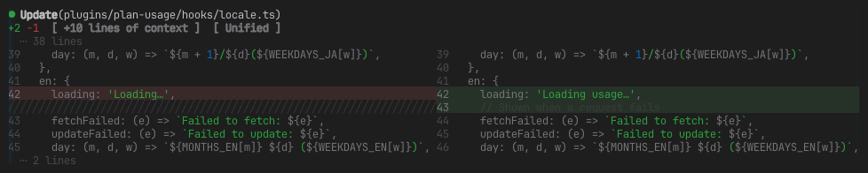
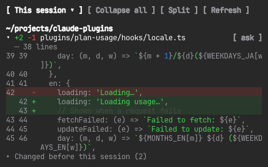

# session-delta

[日本語](README.ja.md)

Shows what Claude changed in your session, in two places.

**In the conversation**, the results of Edit and Write are drawn side by side: the old lines on the left, the new lines on the right, and a faint hatch where one side has no line. The row above each diff has two buttons:

- Widen the context: changes only → 10 more lines on each side → the whole file
- Switch every diff in the conversation between side by side and unified (old and new lines on separate rows)



**In a pane beside the chat**, the `diff` button above the prompt (or `/session-delta`) lists the changed files, grouped by folder. Click a file to expand its diff. The menu at the top chooses what to compare:

- **This session**: uncommitted changes in the git repository, and files Claude edited outside it, compared with their content just before Claude first edited them. Changed files last modified before the session started are folded into a separate row.
- **Whole branch**: changes since the branch left the default branch.
- **One turn**: the Edit and Write changes made for one of your messages, for the 63 most recent turns.

Press **ask** on a file to attach its diff to your next prompt. Test and generated files carry a badge, by the same rules as the built-in `/diff`.



## Requirements

- This plugin is a mod built on function hooks. Enable them with the `CLAUDE_CODE_ENABLE_FUNCTION_HOOKS=1` environment variable (for example in the `env` field of `settings.json`).
- `git` for changes in a repository, and `diff` for files outside one.

## Install

```sh
claude plugin marketplace add crgstar/claude-plugins
claude plugin install session-delta@crgstar
```

## Commands

| Command | What it does |
|---|---|
| `/session-delta` | Opens the change list |
| `/session-delta off` | Leaves diffs in the conversation to the standard view |
| `/session-delta on` | Draws diffs in the conversation side by side again |
| `/session-delta colors` | Opens the color options for diffs |

## Notes

- To compare files outside git, the mod saves a copy of each file just before Claude first edits it in a session, under the plugin's data folder (`~/.claude/plugins/data/session-delta-crgstar/first-touches/`). Files over 1 MB are not copied. A session's copies are removed when a later session starts, once 30 days have passed since they were last updated.
- Files changed outside git by anything other than Edit and Write, such as a Bash command, are not listed. Inside a repository, git shows every change.
- A file outside git that Claude edited before the plugin was loaded in that session shows "diff unavailable", since there is no copy of its earlier content.
- Claude Code does not let plugins run commands that name its settings files, so changes to those files show "diff unavailable".
- Diffs too large to draw are left to the standard view.
- The colors assume a dark terminal background.
- Text is shown in Japanese or English. The `language` setting of Claude Code decides it when set (Japanese → Japanese, anything else → English); otherwise the system locale (`LC_ALL`, `LC_MESSAGES`, `LANG`) does.
